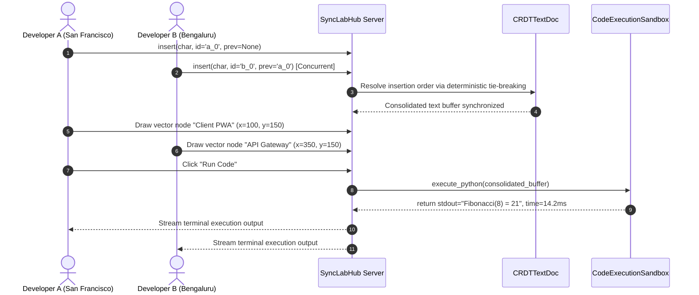

# 🏛️ SyncLab Architecture & Technical Specification

This document provides a formal technical specification of **SyncLab**, a real-time collaborative code editor and vector whiteboard sandbox.

---

## 1. System Topology

```
   ┌───────────────────────┐             ┌───────────────────────┐
   │ Peer A (Dev in SF)    │             │ Peer B (Dev in BLR)   │
   │ - Monaco Editor (CRDT)│             │ - Monaco Editor (CRDT)│
   │ - Vector Canvas Layer │             │ - Vector Canvas Layer │
   └───────────┬───────────┘             └───────────┬───────────┘
               │                                     │
               │ (WebSockets: CRDT Updates & Cursors)│
               ▼                                     ▼
        ┌──────────────────────────────────────────────────┐
        │              SyncLabHub (State Hub)              │
        │  - CRDTTextDoc: Replicated Character Nodes       │
        │  - ArchitectureCanvasSync: 2D Vector Graph       │
        └──────────────────────┬───────────────────────────┘
                               │
                      (Queue Execution Run)
                               ▼
        ┌──────────────────────────────────────────────────┐
        │       CodeExecutionSandbox (Isolated Subprocess) │
        │  - Language: Python 3.10+ / Node.js              │
        │  - Hard Limits: 5000ms Timeout, Resource Capped  │
        └──────────────────────┬───────────────────────────┘
                               │ (stdout / stderr stream)
                               ▼
        ┌──────────────────────────────────────────────────┐
        │       Consolidated Live Terminal Output          │
        └──────────────────────────────────────────────────┘
```

---

## 2. Sequence Diagram (Concurrent Collaboration)



---

## 3. Data Schemas (JSON)

### 3.1 CRDT Node Schema
```json
{
  "$schema": "https://json-schema.org/draft/2020-12/schema",
  "title": "CRDTCharNode",
  "type": "object",
  "properties": {
    "char": { "type": "string" },
    "char_id": { "type": "string" },
    "prev_id": { "type": ["string", "null"] },
    "is_deleted": { "type": "boolean" }
  },
  "required": ["char", "char_id", "is_deleted"]
}
```

### 3.2 Execution Result Schema
```json
{
  "$schema": "https://json-schema.org/draft/2020-12/schema",
  "title": "ExecutionResult",
  "type": "object",
  "properties": {
    "success": { "type": "boolean" },
    "exit_code": { "type": "integer" },
    "stdout": { "type": "string" },
    "stderr": { "type": "string" },
    "execution_time_ms": { "type": "number" }
  },
  "required": ["success", "exit_code", "stdout", "stderr", "execution_time_ms"]
}
```
